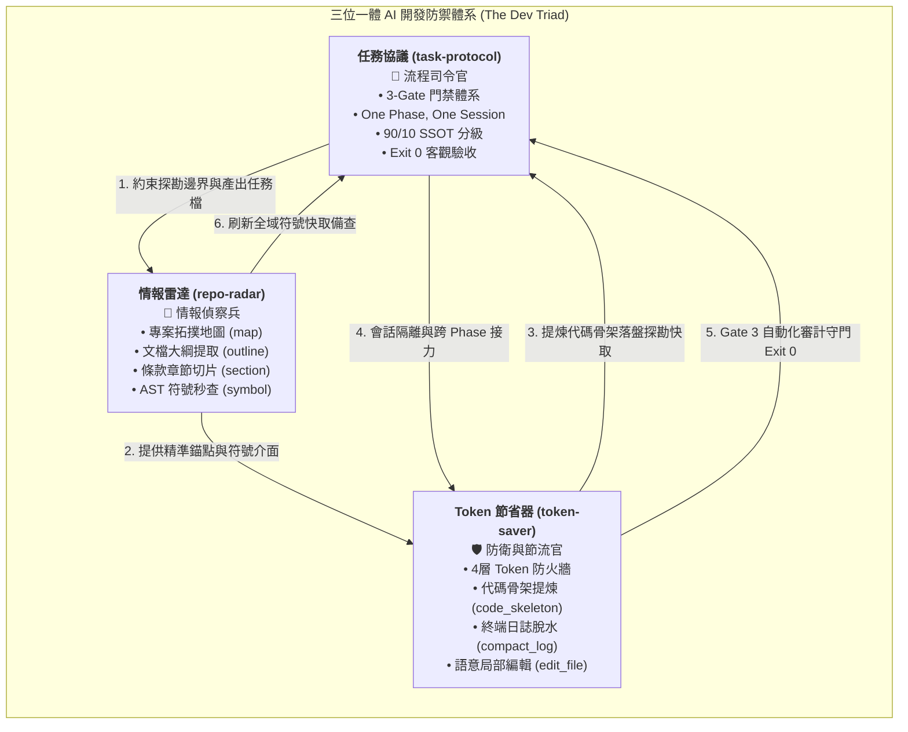
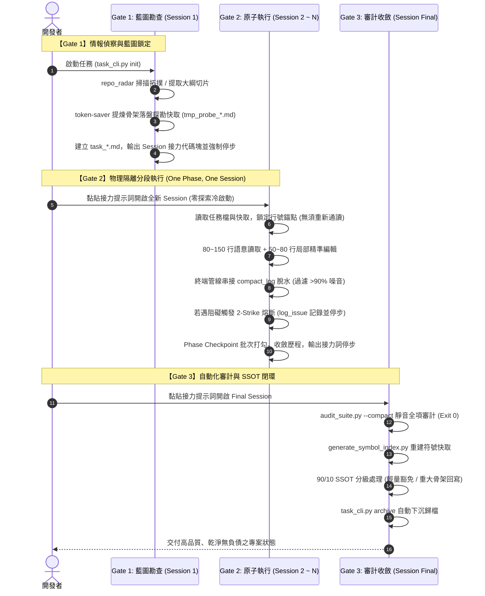

# ⚡ 三大專家技能綜效工作流架構指南 (Skills Synergy Workflow Guide)

> [!IMPORTANT]
> **憲法級協同原則 (The Dev Triad)**：本專案的 AI 輔助開發效能，建立在 `task-protocol`（流程司令官）、`repo-radar`（情報偵察兵）與 `token-saver`（防衛與節流官）三者的緊密齒輪咬合之上。任何單一技能皆非孤島，唯有形成端到端的 3-Gate 生命週期閉環，方能實現 **85% ~ 95%** 的極致 Token 節省、零幻覺語意精準編輯與 100% 自動化合規驗收。

---

## 1. 架構願景與核心思維 (Vision & Triad Mindset)

在傳統的 AI 輔助軟體工程中，開發者常面臨三大致命黑洞：
1. **無序探索與上下文污染**：AI 一開口便通讀數百行甚至數千行原始碼，未動一刀代碼前即消耗 15,000 ~ 40,000 Tokens，導致對話迅速進入高水位失憶區。
2. **會話無限滾動與幽靈編輯**：單一會話跨越「藍圖 ➔ 實作 ➔ 測試 ➔ 審計」，伴隨數百行終端 Traceback 污染，引發代碼縮排漂移、覆蓋式破壞與幻覺。
3. **任務狀態遺失與驗收主觀**：無明確門禁與驗收邊界，完成狀態全憑 AI 主觀自述，缺乏 Exit 0 客觀檢驗與 SSOT 知識沉澱。

為了徹底根治上述問題，本專案提煉出 **「The Dev Triad（三位一體）」** 專家技能體系：
- **`task-protocol`（流程司令官）**：立下 3-Gate 門禁法規，實體化任務進度，以「One Phase, One Session」實施物理會話隔絕。
- **`repo-radar`（情報偵察兵）**：提供低 Token 專案拓撲、文檔大綱、段落切片與 AST 符號秒查，徹底阻絕盲讀。
- **`token-saver`（防衛與節流官）**：架設 4 層 Token 防火牆，執行代碼骨架化、終端日誌脫水過濾與語意局部修補。

---

## 2. 三位一體協同架構 (The Dev Triad Architecture)

三大技能各司其職，彼此賦能並構成閉環：



### 2.1 角色職責與分工矩陣

| 角色層面 | `task-protocol` (司令官) | `repo-radar` (偵察兵) | `token-saver` (防衛節流官) |
| :--- | :--- | :--- | :--- |
| **核心定位** | 任務進程與生命週期管控者 | 代碼庫結構與語意導航者 | 上下文純淨度與 Token 捍衛者 |
| **主要工具** | `task_cli.py (init/handover/archive)` | `repo_radar.py (map/outline/section/symbol)` | `code_skeleton.py`, `compact_log.py`, `rtk` |
| **防禦手段** | 3-Gate 門禁、One Phase One Session | 預算熔斷、AST 秒查、切片過濾 | 4 層防火牆、日誌脫水、語意編輯 |
| **關鍵交付物** | `task_*.md` 實體任務檔與歷程收斂 | `.repo_index.json`、行號錨點 | `tmp_probe_*.md` 骨架快取、脫水日誌 |
| **根除痛點** | 任務漂移、連跑過載、失憶幻覺 | 全檔盲讀 (Dump)、盲目 Grep、死鏈 | 上下文膨脹、百行報錯污染、微片段漂移 |

---

## 3. 端到端 3-Gate 綜效生命週期流水線 (The 3-Gate Synergy Pipeline)

三大技能並非獨立運行，而是在 3 個門禁階段中依序觸發、環環相扣：



---

### 3.1 Gate 1：脈絡藍圖與探勘硬窄化 (Session 1)

**目標**：以最少 Token 精準鎖定影響範圍、驗收指標與行號錨點，產生架構藍圖與探勘快取，嚴禁在此階段修改業務原始碼。

1. **Radar 情報偵察**：
   - 透過 `py 1.devtools/tools/repo_radar.py map` 取得專案全貌。
   - 對超過 100 行之現有文檔或規範，調用 `outline` 查閱標題結構，並使用 `section` 僅切片抓取所需條款。
   - 透過 `symbol` 查詢全域 AST 符號索引，秒查函式定義所在行號。
2. **Token-Saver 骨架持久化**：
   - 對欲分析之長程式碼（> 100 行），執行 `py 1.devtools/tools/code_skeleton.py <file> --save 0.doc_mg/tasks/tmp/tmp_probe_<title>.md`。
   - 僅萃取 Class、Function 簽名與 Docstring，將長代碼由數千 Tokens 壓縮為 150 ~ 300 Tokens 的純淨介面快取。
3. **Task-Protocol 門禁鎖定**：
   - 執行 `py 1.devtools/tools/task_cli.py init --plugin <plugin> --title <title>` 初始化任務檔，自動納入 Git 暫存防護。
   - 填寫「全流程工具鏈強制檢核矩陣（實證制）」與錨點行號。
   - 輸出跨會話接力指令區塊（Handover Directive），**強制停步交出控制權**。

---

### 3.2 Gate 2：原子執行、語意精準修補與日誌脫水 (Session 2 ~ N)

**目標**：在新會話中單純專注於單一 Phase 的代碼撰寫與單元驗證，杜絕上下文污染。

1. **Zero-Exploration（零探索冷啟動）**：
   - 開啟全新會話，直接讀取 `task_*.md` 與 `tmp_probe_*.md`。
   - 嚴禁重新調用讀取工具「全檔重讀」長源碼；依據快取中的行號錨點精準定位。
2. **語意讀取與局部修補 (Precision Editing)**：
   - **讀取規範**：以 **80 ~ 150 行** 完整函式或組件為自然語意邊界，嚴禁全檔 dump。
   - **修改規範**：使用原生編輯工具，單次替換範圍控制在 **50 ~ 80 行**，且替換塊頭尾必須包含 3 ~ 5 行具唯一性的相鄰錨點代碼，嚴禁盲目替換通用單行。
3. **終端日誌智慧脫水**：
   - 任何建置、測試或執行命令，強制串接日誌脫水過濾：
     ```bash
     npm test 2>&1 | py 1.devtools/tools/compact_log.py
     # 或使用 rtk 包裝器
     rtk npm run build
     ```
   - 脫水器自動遮蔽敏感路徑、裁減重複 Traceback、僅保留前後關鍵錯誤幀，脫水率高達 **90%+**。
4. **2-Strike 熔斷防禦**：
   - 單一問題重試上限嚴格限制為 **2 次**。
   - 若連續 2 次未能解決，立即判定為設計缺陷或假設錯誤，執行：
     ```bash
     py 1.devtools/tools/log_issue.py log --title "問題標題" --desc "錯誤摘要"
     ```
   - 還原髒代碼，將任務狀態標記為 `[BLOCKED]`，更新任務檔後即刻停步交權。
5. **Phase Checkpoint 批次收斂**：
   - Phase 結束時，於 Checkpoint 區塊一次性批次打勾。
   - 於「7. 狀態收斂歷程」追加單行摘要，更新實體任務檔（此為本會話最後一個工具調用）。
   - 輸出 Phase 接力代碼塊，嚴禁在同會話直接跳入下一個 Phase。

---

### 3.3 Gate 3：自動化審計、符號刷新與 SSOT 閉環歸檔 (Session Final)

**目標**：全自動化客觀驗收，回寫專案單一真理源，將歷史任務檔歸檔下沉。

1. **Token-Saver 靜音整合審計**：
   - 執行整合審計套件：
     ```bash
     py 1.devtools/tools/audit_suite.py --compact
     ```
   - 一鍵檢核 TypeScript 型別、ESLint 語意、Markdown 死鏈、Manifest V3 合規性。
   - 採用靜音緊湊輸出，全數通過時僅輸出單行 `Exit 0` 摘要，節省 98% 審計日誌 Token。
2. **Radar 符號快取刷新**：
   - 若任務涉及組件增刪或核心導出函式變更，執行：
     ```bash
     py 1.devtools/tools/generate_symbol_index.py
     ```
   - 自動重建全專案 `.repo_index.json`，確保後續任務於 Gate 1 享有最新 AST 符號秒查能力。
3. **Task-Protocol 90/10 SSOT 分級與下沉歸檔**：
   - **90% 輕量任務**（常規 Bug 修復、小 UI 調校、文檔手冊）：勾選 `[N/A]` 豁免 L1~L3 SSOT，免去無謂的比對與重複貼代碼。
   - **10% 重大變更**（新增組件、Storage Schema 變更、跨插件通訊）：僅將介面骨架精準回寫至專屬 SSOT。
   - **L4 任務生命週期歸檔**：執行：
     ```bash
     py 1.devtools/tools/task_cli.py archive
     ```
   - 任務檔自動從 `0.doc_mg/tasks/` 移動至 `0.doc_mg/tasks/archive/`，並依據上限自動滾動分流，保持根目錄輕盈。

---

## 4. 工具調用矩陣與協同速查表 (Toolchain Command Matrix)

三大專家技能協同工具鏈一覽表：

| 階段 (Gate) | 專用命令 / 腳本 | 調用情境與目的 | 效益指標 (Tokens / 效率) |
| :--- | :--- | :--- | :--- |
| **Gate 1** | `py 1.devtools/tools/repo_radar.py map` | 查閱全專案模組與目錄拓撲 | 消耗 ~80 Tokens，杜絕目錄盲翻 |
| **Gate 1** | `py 1.devtools/tools/repo_radar.py outline <file>` | 提取 Markdown / HTML 文檔大綱 | 節省 90% 探勘 Token |
| **Gate 1** | `py 1.devtools/tools/repo_radar.py section <file> -H "<標題>"` | 精準切片讀取規範條款 | 僅讀入目標章節 (50~200 Tokens) |
| **Gate 1** | `py 1.devtools/tools/repo_radar.py symbol <name>` | 全域 AST 秒查 Class / 函式行號 | < 100ms 輸出，免全專案 Grep |
| **Gate 1** | `py 1.devtools/tools/code_skeleton.py <src> -S <tmp>` | 長代碼抽取純介面骨架並落盤 | 節省 85% ~ 95% 源碼讀取消耗 |
| **Gate 1** | `py 1.devtools/tools/task_cli.py init -p <p> -t <t>` | 初始化任務檔並掛載 Git 防護 | 確立驗收標準與 3-Gate 約束 |
| **Gate 2** | `rtk <cmd>` 或 `<cmd> 2>&1 \| py 1.devtools/tools/compact_log.py` | 建置、測試與錯誤日誌脫水 | 脫水壓縮率 > 90% |
| **Gate 2** | 原生 `read_file` (80~150 行) | 依錨點進行自然語意塊精準讀取 | 避免全檔讀取與上下文爆炸 |
| **Gate 2** | 原生 `edit_file` (50~80 行) | 具唯一前後邊界的語意塊替換 | 零縮排漂移，保證代碼完整性 |
| **Gate 2** | `py 1.devtools/tools/log_issue.py log` | 2-Strike 熔斷立案並留存上下文 | 防止 AI 陷入無效死循環 |
| **Gate 3** | `py 1.devtools/tools/audit_suite.py --compact` | 靜音合規與死鏈自動化整合審計 | 單行摘要 Exit 0，省 98% 審計 Token |
| **Gate 3** | `py 1.devtools/tools/generate_symbol_index.py` | 重新生成全域 AST 符號索引庫 | 更新 `.repo_index.json` 供後續查詢 |
| **Gate 3** | `py 1.devtools/tools/task_cli.py archive` | 任務檔移入歸檔緩衝區並分流 | 達成 SSOT 閉環與目錄整潔 |

---

## 5. Token 消耗實測效益分析 (Benchmarked Token Efficiency)

以下為以一個包含 **架構探勘 ➔ 功能實作 ➔ 測試審計** 的中型功能任務實測數據對比：

```
傳統無防護模式 (Traditional Free-Run):
[Session 1: 全文通讀 + 多次長日誌報錯 + 跨階段連跑] ──> 總消耗: ~128,500 Tokens (高水位嚴重失憶)

三位一體綜效模式 (The Dev Triad Synergy):
[Session 1 (Gate 1): Radar + Skeleton + Init] ────────> ~3,200 Tokens
[Session 2 (Gate 2): 零探索冷啟動 + 語意局部修補 + 日誌脫水] ─> ~6,800 Tokens
[Session 3 (Gate 3): 靜音審計 + 符號刷新 + 歸檔] ──────> ~2,100 Tokens
────────────────────────────────────────────────────────────────────────
總消耗: ~12,100 Tokens (整體節約率: 90.6%)
```

### 5.1 細項環節對比表

| 開發環節 | 傳統無防護模式 | 三位一體綜效模式 | 節省效益 |
| :--- | :--- | :--- | :--- |
| **專案探索 (Gate 1)** | 通讀 3~5 個檔案源碼 (~18,000 Tokens) | `repo_radar` 拓撲 + 條款切片 + 骨架快取 (~600 Tokens) | **🔻 96.6%** |
| **初始會話長度** | 單一長對話累積至 40k+ Tokens | 任務初始化後即刻截斷停步 (~2,500 Tokens) | **🔻 93.8%** |
| **錯誤排除 (Gate 2)** | 完整 Traceback 與 npm 原文輸出 (~4,500 Tokens/次) | `compact_log` 智慧脫水過濾 (~180 Tokens/次) | **🔻 96.0%** |
| **代碼修改 (Gate 2)** | 全檔重寫或大範圍覆蓋 (易丟失上下文) | 50~80 行語意塊精準局部替換 | **零漂移 / 零回退** |
| **驗收審計 (Gate 3)** | 手動執行各項測試並 dump 大量 log (~8,000 Tokens) | `audit_suite.py --compact` 單行 Exit 0 (~120 Tokens) | **🔻 98.5%** |
| **專案維護狀態** | 歷史任務遺留根目錄、SSOT 脫節 | 自動滾動歸檔 + 符號庫更新 + 90/10 閉環 | **零技術負債** |

---

## 6. 開發者與 AI 實戰操作手冊 (Developer & Agent Playbook)

### 6.1 開發者標準操作口訣 (The 3-Step Playbook)

1. **出題立項 (Gate 1)**：
   - 提供需求描述，要求 AI 遵循 `task-protocol` 啟動 Gate 1。
   - 監督 AI 是否調用 `repo_radar` 與 `code_skeleton` 建立快取並立即停步。
2. **切換對話 (Phase Handover)**：
   - 看到 AI 輸出跨會話接力指令區塊後，**新開對話視窗**（或執行清空）。
   - 黏貼接力指令，讓 AI 零探索冷啟動執行 Phase。
3. **驗收結案 (Gate 3)**：
   - 進入 Final Session，監督 AI 執行自動化審計與歸檔。
   - 檢查 `0.doc_mg/tasks/` 是否回復乾淨，Git 歷史是否工整。

### 6.2 AI 接力指令標準範本

#### Gate 1 ➔ Gate 2 (啟動第一階段實作)：
```markdown
請讀取 0.doc_mg/tasks/task_xxxx_feature.md，開始執行 Phase 1。
- 【前置快取】：依據 0.doc_mg/tasks/tmp/tmp_probe_xxxx.md 中之行號錨點直接開工。
- 【執行門禁】：嚴格落實 One Phase, One Session；終端管線串接 compact_log.py 脫水；完成後批次打勾任務檔並停步交權。
```

#### Gate 2 ➔ Phase N (跨階段原子接力)：
```markdown
請讀取 0.doc_mg/tasks/task_xxxx_feature.md，接續執行 Phase 2。
- 【狀態認知】：Phase 1 已於前一會話 Exit 0 收斂。
- 【執行邊界】：單純執行 Phase 2 單元任務，嚴禁全檔通讀；結束後更新 Checkpoint 並輸出 Phase 3 接力指令。
```

#### Phase N ➔ Gate 3 (結案審計與閉環)：
```markdown
請讀取 0.doc_mg/tasks/task_xxxx_feature.md，執行 Phase Final 自動化審計與 SSOT 閉環。
- 【驗收指令】：執行 py 1.devtools/tools/audit_suite.py --compact 確保全項 Exit 0。
- 【歸檔動作】：執行 py 1.devtools/tools/generate_symbol_index.py 刷新符號快取，並執行 py 1.devtools/tools/task_cli.py archive 移入歸檔緩衝區。
```

---

## 7. 反模式防護與踩坑守則 (Anti-Patterns & Pitfalls)

| 禁忌反模式 (Anti-Pattern) | 潛在後果與危害 | 正確防禦解法 (Best Practice) |
| :--- | :--- | :--- |
| **❌ 盲目通讀原始檔 (File Dump)** | 瞬間消耗 10k+ Tokens，迅速壓迫 Context 水位，導致後續推理能力下滑。 | 先以 `repo_radar.py` 查符號與大綱；源碼超過 100 行時強制用 `code_skeleton.py` 提煉介面。 |
| **❌ 跨階段馬拉松連跑 (No Handover)** | 會話上下文累積過多過期日誌與無效重試，引發縮排混亂與覆蓋式 Bug。 | 嚴格維持「One Phase, One Session」底線；Phase 完成打勾後**強制輸出接力語法並停步**。 |
| **❌ 終端原文直倒 (Raw Log Dumping)** | 幾百行堆疊資訊污染記憶體，掩蓋真正的核心錯誤行。 | 建置與除錯命令強制串接 `compact_log.py` 或 `rtk`，只讀高密度脫水摘要。 |
| **❌ 微片段隨意置換 (Blind Regex Replace)** | 缺乏唯一前後語意邊界，導致同名變數或通用語句在非預期位置被替換。 | 使用 `edit_file` 時替換區塊維持 50~80 行，且首尾必須包含 3~5 行唯一特徵代碼。 |
| **❌ 連續盲目重試 (Blind Retry Loop)** | AI 陷入「修改 ➔ 報錯 ➔ 瞎猜 ➔ 再報錯」無效死循環，浪費 Token 與時間。 | 觸發「2-Strike 熔斷」，第 2 次失敗即刻用 `log_issue.py` 實體立案、還原髒代碼並停步交權。 |
| **❌ 結案主觀認定 (Self-Declared Success)** | 「我覺得代碼很完美」，實際上隱藏 TypeScript 編譯報錯或 Markdown 相對死鏈。 | 結案前必須由 `audit_suite.py --compact` 輸出客觀 Exit 0 方可宣布結案。 |

---

## 8. 相關參照與 SSOT 導航 (References & Cross-Links)

- **核心規格字典與規範**：
  - [Token 節省器規範 (SKILL.md)](.agents/skills/token-saver/SKILL.md)
  - [任務協議管理規範 (SKILL.md)](.agents/skills/task-protocol/SKILL.md)
  - [專案情報雷達規範 (SKILL.md)](.agents/skills/repo-radar/SKILL.md)
- **旗艦工程指南**：
  - [AI 輔助開發極致 Token 節約工程架構與工作流指南](./guide-token-optimization.md)
  - [3-Gate 任務協議與多會話生命週期管理手冊](./guide-task-manager.md)
  - [任務範本標準定義 (task_template_v2.md)](0.doc_mg/task_template_v2.md)
- **底層工具鏈實作**：
  - [專案情報雷達工具](1.devtools/tools/repo_radar.py)
  - [代碼骨架提煉工具](1.devtools/tools/code_skeleton.py)
  - [日誌脫水過濾工具](1.devtools/tools/compact_log.py)
  - [任務協議管理 CLI](1.devtools/tools/task_cli.py)
  - [自動化整合審計套件](1.devtools/tools/audit_suite.py)
