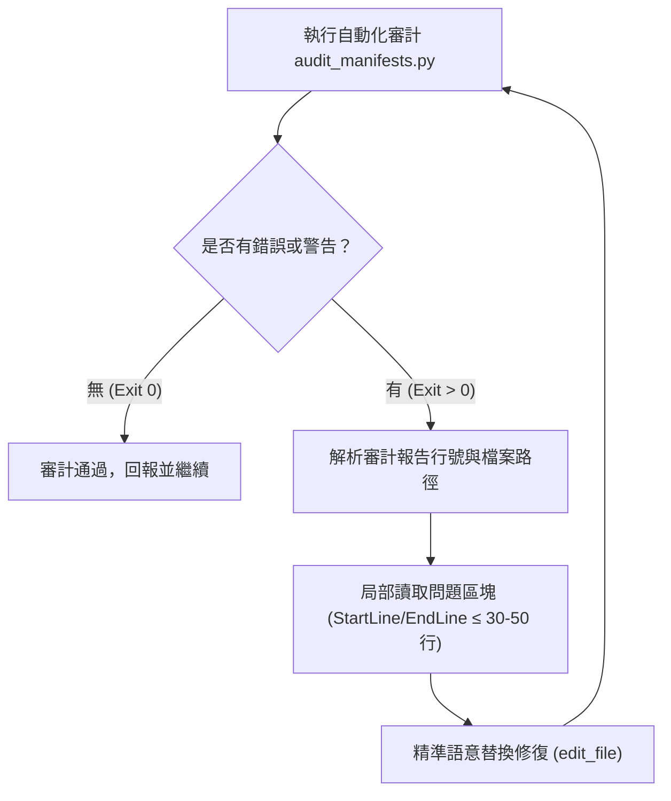

# 🛡️ Chrome 插件合規審計核心規格 (Chrome Compliance Auditor Spec)

本規格文檔為 Chrome 插件合規審計技能 (`.agents/skills/chrome-auditor/SKILL.md`) 之專屬下沉規格文檔 (SSOT)，詳載 Manifest V3 合規、CSP 安全防禦、XSS 漏洞防範與自動化審計工具鏈規範。

---

## 1. 核心定位與審計範圍 (Objective & Scope)

- **目標**：在開發、重構或提交 Chrome 擴充功能前，提供全自動靜態安全與合規審計，預先杜絕 Chrome Web Store 上架審查遭拒與本機執行風險。
- **範疇**：
  - Monorepo 全域五大擴充模組 (`chrome_pk`, `chrome_gemini_nano`, `browser-activity-monitor`, `chrome_video speed plus`, `finance-research-clipper-oss`) 與未來新增擴充套件。
  - 所有 `manifest.json` 配置檔及關聯之 HTML、JavaScript、TypeScript 原始碼檔案。

---

## 2. 審計維度與規則矩陣 (Audit Rules Matrix)

### 2.1 Manifest V3 架構合規

| 檢查項目 | 規則代號 | 合規標準 | 違規處置 |
| :--- | :--- | :--- | :--- |
| **Manifest 版本** | MV3-VER-01 | `manifest_version: 3` | 阻斷 (Error) |
| **必備中繼資料** | MV3-META-01 | 包含 `name`, `version`, `manifest_version`, `description`, `icons` | 阻斷 (Error) |
| **背景服務程序** | MV3-BG-01 | 必須為非持續性 `background.service_worker`，嚴禁 MV2 之 `scripts` 陣列或 `persistent` | 阻斷 (Error) |
| **實體資源路徑** | MV3-RES-01 | `icons`, `service_worker`, `content_scripts.js`, `content_scripts.css`, `action.default_popup` 所指向之實體檔案必須存在 | 阻斷 (Error) |
| **權限最小化** | MV3-PERM-01 | 避免無故宣告 `<all_urls>` 或高危權限；能用 `activeTab` 替代者優先降級 | 警示 (Warning) |

### 2.2 CSP (內容安全策略) 與動態代碼審查

| 檢查項目 | 規則代號 | 合規標準 | 違規處置 |
| :--- | :--- | :--- | :--- |
| **動態代碼求值** | CSP-EVAL-01 | 嚴禁出現 `eval()` 呼叫，嚴禁利用任何別名包裝執行字串代碼 | 阻斷 (Error) |
| **字串構造函式** | CSP-FUNC-01 | 嚴禁出現 `new Function(...)` 動態建構可執行函式 | 阻斷 (Error) |
| **遠端腳本載入** | CSP-REMOTE-01 | 嚴禁自外部 CDN 或非插件本機路徑載入任何可執行 JS/Wasm 檔案 | 阻斷 (Error) |
| **行內事件處理器** | CSP-INLINE-01 | 嚴禁在 HTML 標籤中使用 `onclick`, `onload` 等行內 JavaScript 屬性 | 阻斷 (Error) |

### 2.3 XSS 跨站腳本攻擊防範

| 檢查項目 | 規則代號 | 合規標準 | 違規處置 |
| :--- | :--- | :--- | :--- |
| **未消毒 innerHTML** | XSS-HTML-01 | 嚴禁將未經白名單過濾之變數直接指派給 `element.innerHTML`；非必要一律使用 `.textContent` | 阻斷/警示 (Error/Warning) |
| **安全消毒庫規範** | XSS-SANI-01 | 若確有渲染 HTML 標籤需求，必須使用 `DOMPurify` 進行清洗與消毒 | 稽核放行 |
| **URL 跳轉防護** | XSS-URI-01 | 動態賦值 `href` 或 `src` 時，嚴禁 `javascript:` 偽協議 | 阻斷 (Error) |

---

## 3. 自動化審計工具鏈 (Toolchain & Execution)

### 3.1 核心審計工具

1. **Manifest 與安全掃描器**:
   - 檔案路徑: `1.devtools/tools/audit_manifests.py`
   - 單獨執行:
     ```bash
     python 1.devtools/tools/audit_manifests.py
     ```
   - 精簡輸出:
     ```bash
     python 1.devtools/tools/audit_manifests.py --compact
     ```
2. **全域整合審計套件**:
   - 檔案路徑: `1.devtools/tools/audit_suite.py`
   - 全項驗收:
     ```bash
     python 1.devtools/tools/audit_suite.py --compact
     ```

### 3.2 終端日誌脫水整合
為避免大量終端輸出消耗 Token，審計指令必須串接脫水過濾器：
```bash
python 1.devtools/tools/audit_manifests.py 2>&1 | python 1.devtools/tools/compact_log.py
```

---

## 4. 故障排除與修復工作流 (Remediation Workflow)



- **增量局部修復**：嚴禁因單點審計報錯而重寫整個檔案，以最小更動行數消滅違規項。
- **無死鏈保證**：審計相關文檔內部一律使用純行內代碼參照，嚴禁使用易斷鏈之內部 Markdown 超連結。

