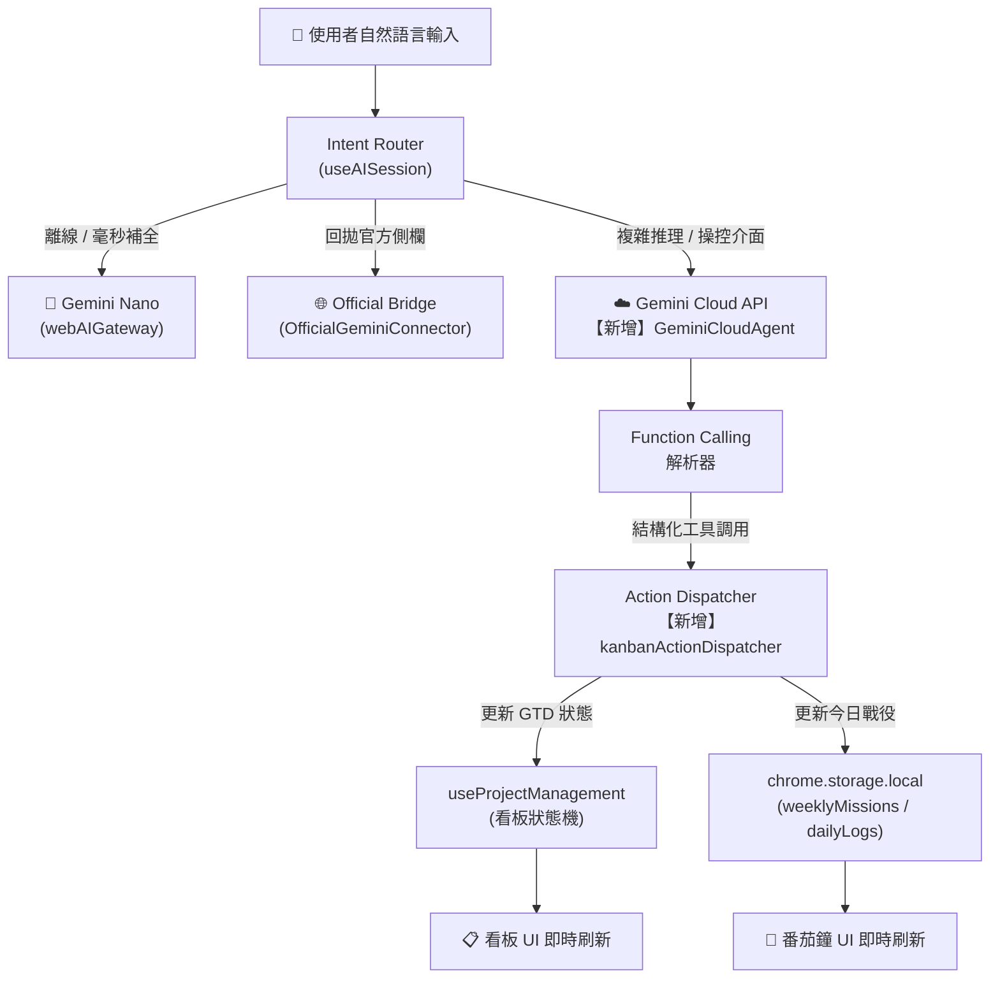
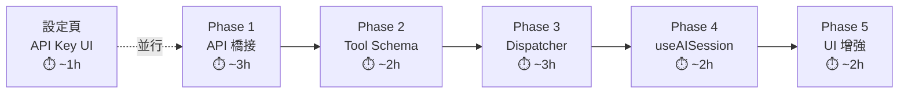

# PK+ Gemini Cloud Agent 升級規劃
> **任務代號**：`task_1031_03` | **狀態**：📋 Blueprint | **日期**：2026-10-31

---

## 一、升級目標與現狀分析

### 1.1 現狀盤點（已有基礎）

| 層級 | 現有模組 | 現有能力 | 升級缺口 |
|------|---------|---------|---------|
| **AI 核心** | `webAIGateway.ts` | Nano summarize / write | 無 Function Calling |
| **AI 核心** | `OfficialGeminiConnector.ts` | 橋接回拋官方側欄 | 無直接雲端 API 呼叫 |
| **AI 核心** | `taskAIEngine.ts` | Nano 驅動的 triage/decompose | 受 Nano token 上限限制 |
| **會話層** | `useAISession.ts` | local_nano / official_bridge 雙模切換 | 缺少 `gemini_cloud` 第三模式 |
| **看板** | `useProjectManagement.ts` | 完整 GTD 狀態機 | 無 Agent 可調用之標準 Tool |
| **看板** | `kanbanAuditor.ts` | WIP 健康巡檢 | 無法被 AI 主動觸發 |
| **UI** | `AIAssistantView.tsx` | 對話 + 模式切換 Tab | 缺 Function Call 結果可視化 |

### 1.2 核心升級目標

```
Gemini Nano（文字補全）  →  Gemini Cloud API（結構化 Function Calling Agent）
「問答助理」             →  「自然語言指揮官」（可直接操控看板狀態）
```

---

## 二、系統架構：三引擎分流



### 2.1 三模式職責劃分

| 模式 | 引擎 | 觸發場景 | Function Calling |
|------|------|---------|-----------------|
| `local_nano` | Gemini Nano | 離線、毫秒補全、簡易問答 | ❌ |
| `official_bridge` | 官方 Gemini 側欄回拋 | 需要官方 Gemini 完整對話 | ❌ |
| **`gemini_cloud`** ← 新增 | Gemini Flash/Pro API | 操控介面、複雜推理、看板管理 | ✅ |

---

## 三、新增檔案清單（最小改動原則）

```
chrome_pk/src/
├── core/ai/
│   └── GeminiCloudAgent.ts          ← 【新增】雲端 API + Function Calling 核心
├── features/project-management/
│   └── services/
│       └── kanbanActionDispatcher.ts ← 【新增】看板指令分發器（WIP 守門）
└── entries/sidebar/
    └── hooks/
        └── useAISession.ts          ← 【修改】新增 gemini_cloud 第三模式
    └── components/
        └── AIAssistantView.tsx      ← 【修改】新增 Function Call 結果 UI
```

> [!IMPORTANT]
> **嚴禁改動**：`webAIGateway.ts`（黑盒橋接層）、`OfficialGeminiConnector.ts`（Phase 2 已穩定）、`useProjectManagement.ts` 核心狀態邏輯（只掛載新 dispatcher）。

---

## 四、Phase 規劃（Gate 2 原子執行單元）

### Phase 1 — API 橋接層建立（`GeminiCloudAgent.ts`）

**目標**：打通 Gemini API 直連通道，支援 Streaming 輸出與 API Key 管理。

**實作要點**：
- 讀取 `chrome.storage.local` 中的 `geminiApiKey` 與 `geminiModel`（由全域設定寫入）
- 使用 `@google/genai` SDK 或 REST API（`generativelanguage.googleapis.com`）
- 支援 SSE Streaming → 打字機效果輸出
- 介面對齊 `useAISession` 的 `aiSessionRef.current.prompt()` 呼叫方式（最小改動）

**驗收標準**：
- [ ] 在全域設定中填入 API Key 後，`gemini_cloud` 模式能正常發送並接收回覆
- [ ] Streaming 輸出可見打字機效果
- [ ] API Key 不明文暴露於 console log

---

### Phase 2 — Tool Schema 宣告（`GeminiCloudAgent.ts`）

**目標**：為 Gemini 定義可操控 PK+ 的標準 Tool，使其能回傳結構化 Function Call。

**工具集（`PK_TOOLS`）**：

```typescript
// 核心四工具
add_task(title, priority, estimatedPomodoros, destination)
split_task(parentTaskId, parentTitle, subtasks[])
move_task_stage(taskId, targetStage)          // 含 WIP 守門
trigger_cloud_sync(target)                    // google_tasks | sheets
mark_task_done(taskId)                        // 勾選完成
start_pomodoro_sprint()                       // 啟動番茄鐘衝刺
generate_standup_report()                     // 站會三問生成
```

**Context 注入格式**（隨每次請求打包）：

```json
{
  "workspaceContext": {
    "currentView": "專案規劃看板",
    "wipLimit": 3,
    "columns": {
      "nextActions": [{ "id": "task_001", "title": "完成產品規格書", "pomodoros": 2 }],
      "inProgress": [],
      "inbox": []
    },
    "todayCoreBattles": [{ "missionId": "task_001", "title": "完成產品規格書" }],
    "timerRunning": false,
    "syncState": { "googleTasksLastSync": "14:21" }
  }
}
```

**驗收標準**：
- [ ] 輸入「幫我把 React Hooks 拆解成三個番茄鐘」→ 模型回傳 `split_task` Function Call
- [ ] 輸入「今天下午把規格書的 API 章節排進去，2 個番茄」→ 模型回傳 `add_task`

---

### Phase 3 — 看板指令分發器（`kanbanActionDispatcher.ts`）

**目標**：接管 Function Call 輸出，含 WIP 守門，直接更新看板狀態。

**設計原則**：
- **增量操作**（新增任務、拆解子任務）：直接執行 + 視覺高亮動畫
- **破壞性操作**（刪除、清空）：彈出確認按鈕（Human-in-the-loop）
- **WIP 衝突**：攔截並回傳 AI 友好錯誤訊息，由 Copilot 提示使用者

```typescript
// WIP 守門邏輯（繼承 kanbanAuditor 邏輯）
case "move_task_stage":
  if (targetStage === "in_progress") {
    const report = kanbanAuditor.auditBoard(missions, wipLimit);
    if (report.wipSaturation >= 1.0) {
      return { success: false, error: `WIP 上限 (${inProgressCount}/${wipLimit})，請先推進既有任務。` };
    }
  }
```

**驗收標準**：
- [ ] `split_task` 執行後，看板 UI 中該任務下出現對應子任務卡片
- [ ] `move_task_stage` 到 `in_progress` 時，WIP 超限正確攔截並提示
- [ ] 破壞性操作出現確認 Modal

---

### Phase 4 — `useAISession` 第三模式整合

**目標**：在現有 `local_nano | official_bridge` 雙模切換基礎上，新增 `gemini_cloud` 第三模式。

**修改範圍（最小）**：
- `AIMode` 類型新增 `'gemini_cloud'`
- `handleToggleAIMode` 改為三態循環：`local_nano → gemini_cloud → official_bridge`
- `handleSend` 新增 `gemini_cloud` 分支：呼叫 `GeminiCloudAgent.sendWithTools()`
- Function Call 結果注入 `messages` 顯示（Action Report 氣泡）

**驗收標準**：
- [ ] 模式切換按鈕正確顯示 `🧠 Nano` / `☁️ Cloud` / `🌐 官方` 三態
- [ ] Cloud 模式下對話框正確顯示 Function Call 執行結果氣泡

---

### Phase 5 — UI 增強（`AIAssistantView.tsx`）

**目標**：讓 Function Call 結果有對應的視覺回饋，完成 Agent 閉環。

**新增 UI 元素**：

| 元件 | 說明 |
|------|------|
| **Action Report 氣泡** | 顯示「✅ 已將『React Hooks』拆解為 3 個子任務並排入看板」 |
| **WIP 警告橫幅** | 當 AI 嘗試超過 WIP 限制時，橫幅提示與建議 |
| **確認 Modal** | 破壞性操作前彈出，含「確認執行」按鈕 |
| **情境快取指示器** | 頂部小標：「已載入看板快照：2 項 Next Actions」 |

---

## 五、場景示例（驗收參照）

### 場景 A：自然語言新增任務
```
使用者：「今天下午想搞定產品規格書的 API 串接章節，預計 2 個番茄」
AI 執行：add_task("撰寫規格書：API 串接章節", priority="P2", pomodoros=2)
UI 效果：看板 Next Actions 欄位立刻出現新卡片 ✨
```

### 場景 B：智慧任務拆解
```
使用者：「幫我把『學習 React Hooks』細拆並排進戰役」
AI 執行：split_task("task_002", subtasks=[
  { title: "掌握 useState 與 useEffect", pomodoros: 1 },
  { title: "實作 Custom Hook 範例", pomodoros: 1 },
  { title: "整合至 PK+ 元件測試", pomodoros: 1 }
])
UI 效果：原任務展開三個子任務卡片，並自動推入今日戰役
```

### 場景 C：站會三問生成
```
使用者：「幫我生成今天的站會報告」
AI 執行：generate_standup_report()
AI 產出：
  昨日完成：...
  今日焦點（嚴守 WIP=3）：...
  潛在 Blocker：...
UI 效果：右側 Copilot 顯示報告，「一鍵排入今日戰役」按鈕可用
```

### 場景 D：WIP 衝突仲裁
```
使用者：「把收件匣裡的財務報告任務移進進行中」
AI 執行：move_task_stage("task_005", "in_progress")
系統攔截：WIP 已滿 (3/3)
AI 回覆：「目前進行中已達上限 3 項，建議先推進『完成產品規格書』至完成，
          再啟動財務報告。是否需要我幫你重新排優先級？」
```

---

## 六、全域設定新增項目

在「⚙️ 全域設定」新增 **AI 助理設定** 區塊：

| 設定項 | 類型 | 說明 |
|--------|------|------|
| `geminiApiKey` | `password input` | Gemini API Key（加密存入 storage） |
| `geminiModel` | `select` | `gemini-2.0-flash` / `gemini-1.5-pro` |
| `geminiDefaultMode` | `select` | 預設引擎模式 |
| `enableFunctionCalling` | `toggle` | 是否啟用介面操控能力 |
| `wipGuardEnabled` | `toggle` | WIP 守門是否生效 |

---

## 七、執行優先序建議



> [!TIP]
> **建議起點**：先完成「設定頁 API Key 輸入」+ Phase 1（打通 API），即可驗證雲端對話能力。Phase 3（Dispatcher）是最核心的突破點，建議獨立一個 Gate 2 Session 執行。

> [!WARNING]
> **邊界紅線**：`webAIGateway.ts` 為跨插件黑盒契約，嚴禁在此次升級中直接修改其原始碼。所有雲端 Agent 邏輯統一封裝於新建的 `GeminiCloudAgent.ts`。
