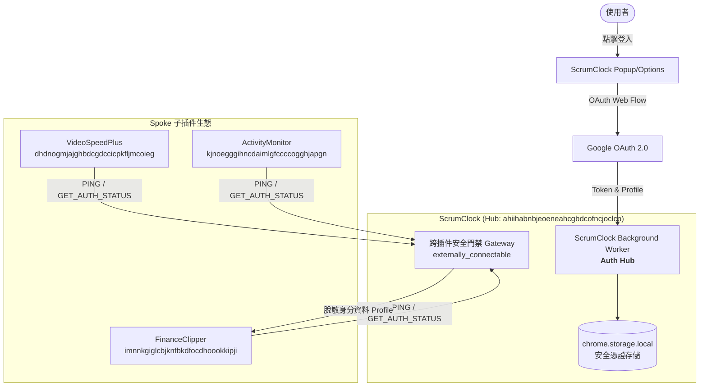

# ScrumClock 跨插件認證中台 (Auth Hub) 開發需求規格說明書 (PRD / Draft)

> **文檔狀態**：草稿審閱中 (Draft)  
> **建立日期**：2026-10-13  
> **負責模組**：`chrome_scrumclock/` (Auth Hub) & 跨插件客戶端 (Spokes)  
> **對齊文檔**：`0.doc_mg/docs/cross_plugin_contract.md`

---

## 1. 背景與目標 (Background & Objectives)

### 1.1 背景
ScrumClock 已成功完成 Google OAuth 2.0 Web Auth Flow (Phase 1~3)，具備穩定的本機 Token 交換、快取與使用者 Profile 管理能力。  
在 `chrome-plus` 多插件工作區生態中，包含 FinanceClipper、VideoSpeedPlus、ActivityMonitor 等多個獨立插件。若各插件各自實作 Google 登入，將面臨：
1. 需在 Google Cloud Console 為每個插件註冊獨立 Client ID。
2. 使用者必須在各插件重複點擊授權與登入，操作體驗零碎。
3. 每個插件均需宣告敏感的 `identity` 權限，增加 Chrome Web Store 審查風險。

### 1.2 目標
以 **ScrumClock** 作為**全生態 SSO 認證中台 (Auth Hub)**：
- **一次登入，全域共享**：使用者在 ScrumClock 登入 Google 後，所有友方子插件自動獲得登入狀態與授權身分。
- **黑盒通訊契約**：嚴格遵循零構建解耦架構，子插件僅透過 `chrome.runtime.sendMessage` 與標準 JSON RPC 通訊，不直接依賴 OAuth 實作細節。
- **極致安全防護**：ScrumClock 透過 `externally_connectable` 與白名單過濾，對外僅暴露脫敏後的身分資訊（如 email, name, avatar），絕不洩漏底層 Refresh Token 或憑證金鑰。
- **優雅降級 (Graceful Fallback)**：當使用者未安裝或停用 ScrumClock 時，子插件自動降級為「本機離線模式」，不中斷其原生核心功能。

---

## 2. 系統架構與角色職責 (Architecture & Roles)



### 2.1 節點角色定義
1. **認證中台 (Auth Hub) - ScrumClock**
   - 恆定 Extension ID：`ahiihabnbjeoeneahcgbdcofncjoclcp`
   - 職責：發起 Google 授權視窗、儲存加密憑證、管理 Token 生命週期、對外提供白名單 RPC 接口。
2. **子插件客戶端 (Spokes) - FinanceClipper, VideoSpeedPlus, ActivityMonitor 等**
   - 職責：透過純資料訊息查詢驗證狀態；無登入狀態時提示使用者開啟 ScrumClock 登入，或運行於唯讀離線模式。

---

## 3. 功能需求規格 (Functional Requirements)

### FR-1: 外部通訊門禁與白名單過濾 (External Access Gateway)
* **描述**：ScrumClock 需在 `manifest.json` 開放 `externally_connectable`，並在 Service Worker 中實體校驗呼叫端 `sender.id`。
* **白名單清單**：
  * `imnnkgiglcbjknfbkdfocdhoookkipji` (FinanceClipper)
  * `dhdnogmjajghbdcgdccicpkfljmcoieg` (VideoSpeedPlus)
  * `kjnoegggihncdaimlgfccccogghjapgn` (ActivityMonitor)
* **行為**：非白名單來源一律回傳 `{ success: false, error: 'UNAUTHORIZED_CALLER' }` 並拒絕處理。

### FR-2: 探活與握手機制 (Ping / Health Check)
* **描述**：子插件在初始化或連線前，可發送 `PING` 探測 ScrumClock 是否處於啟動狀態。
* **行為**：Hub 立即回傳版本號、支援協議版本與就緒狀態。若超時（預設 2.5 秒）則判定 Hub 未安裝或未啟用。

### FR-3: 身分驗證狀態查詢 (Get Auth Status & Profile)
* **描述**：子插件發送 `GET_AUTH_STATUS` 請求。
* **安全脫敏原則**：
  * **允許輸出**：`isAuthenticated` (boolean), `user` ({ id, email, name, picture })。
  * **嚴禁輸出**：Google Access Token、Client Secret、內部 state 或 storage key。
  * 若子插件未來需代發 Google API，由 Hub 提供代理通道（Proxy Action），不直接給予 Token。

### FR-4: 子插件喚醒登入引導 (Request Interactive Login)
* **描述**：若使用者在子插件點擊「登入 Google」，子插件發送 `REQUEST_LOGIN` 請求。
* **行為**：
  * ScrumClock 接收後，自動於前台開啟登入視窗（或彈出 ScrumClock 授權流程）。
  * 授權完成後，回傳最新使用者資訊，或透過事件廣播通知。

### FR-5: 認證狀態變更廣播 (Auth State Broadcast)
* **描述**：當使用者在 ScrumClock 主動「登入」或「登出」時，Hub 巡迴通知已註冊之白名單子插件：
  * 廣播訊息型別：`AUTH_STATE_CHANGED`。
  * 子插件接收到事件後即時刷新自身 UI（例如顯示頭像或回到未登入狀態）。

---

## 4. 跨插件通訊協定定義 (Protocol Schema v2)

所有通訊遵守 `protocolVersion: 2` 與標準 RPC 封裝：

### 4.1 請求格式 (Client -> Hub)
```typescript
interface CrossPluginAuthRequest {
  protocolVersion: 2;
  type: 'PING' | 'GET_AUTH_STATUS' | 'REQUEST_LOGIN' | 'REQUEST_LOGOUT';
  sourcePlugin: string; // 例如 'FINANCE_CLIPPER'
  timestamp: number;
}
```

### 4.2 回應格式 (Hub -> Client)
```typescript
interface CrossPluginAuthResponse<T = any> {
  protocolVersion: 2;
  success: boolean;
  data?: T;
  error?: {
    code: 'UNAUTHORIZED_CALLER' | 'NOT_LOGGED_IN' | 'OAUTH_WINDOW_CLOSED' | 'TIMEOUT' | 'UNKNOWN';
    message: string;
  };
}
```

### 4.3 核心 Payload 範例
#### (1) `GET_AUTH_STATUS` 回應資料
```json
{
  "protocolVersion": 2,
  "success": true,
  "data": {
    "isAuthenticated": true,
    "user": {
      "id": "1098234710293847102",
      "email": "developer@example.com",
      "name": "Alex Chen",
      "picture": "https://lh3.googleusercontent.com/a/..."
    },
    "hubVersion": "1.0.0"
  }
}
```

#### (2) `PING` 回應資料
```json
{
  "protocolVersion": 2,
  "success": true,
  "data": {
    "status": "READY",
    "protocolVersion": 2,
    "hubExtensionId": "ahiihabnbjeoeneahcgbdcofncjoclcp"
  }
}
```

---

## 5. 安全與防禦性規範 (Security & Defensive Standards)

1. **零污染與白名單檢驗**：
   - 接收端必須檢驗 `sender.id`，嚴格比對靜態 RSA 生成的固定 Extension ID。
2. **通訊保險絲 (Circuit Breaker)**：
   - 所有子插件發送請求時，必須包裝 `Promise.race` 與 `setTimeout(5000)`，防止 Hub 無響應導致前端 UI 掛起。
3. **無輪詢喚醒 (Zero Background Polling)**：
   - 不採用定時 Alarm 查詢登入狀態，僅在「子插件 UI 打開時查詢」或由 Hub 在「登入/登出實體動作發生時推送通知」。
4. **本機容錯降級 (Tolerant Reader & Fallback)**：
   - 若連線失敗，子插件直接進入 `isOffline: true` 模式，保留本機 LocalStorage / IndexedDB 操作能力。

---

## 6. 分期落地規劃 (Implementation Roadmap)

| 階段 | 實作重點 | 涉及專案/檔案 | 驗收標準 |
| :--- | :--- | :--- | :--- |
| **Phase 1** | **Hub 門禁開放與監聽** | `chrome_scrumclock/manifest.json`<br/>`chrome_scrumclock/src/background/externalAuthService.ts` | 允許白名單插件以 `sendMessage` 發送 `PING` 與 `GET_AUTH_STATUS`，非白名單拒絕。 |
| **Phase 2** | **跨插件 Auth Client SDK 封裝** | `0.doc_mg/docs/cross_plugin_contract.md`<br/>各子插件 `authClient.js` | 封裝 0 依賴的純 JS 函式庫，具備 3 秒超時保險絲與安全降級。 |
| **Phase 3** | **首發試點接入 (FinanceClipper)** | `finance-research-clipper-oss/` | FinanceClipper 側邊欄能即時讀取 ScrumClock 登入身分與頭像，點擊登入能呼叫 ScrumClock。 |
| **Phase 4** | **狀態變更動態廣播** | ScrumClock `authService.ts` | 當 ScrumClock 登入或登出時，即時推播事件給已開啟的子插件視窗。 |

---

## 7. 結論與下一步
本規格書將作為跨插件認證生態之頂層基準。確認無誤後，可進入 **Gate 1** 建立 Phase 1 的原子任務清單，開始實作 ScrumClock Hub 的外部門禁服務。
