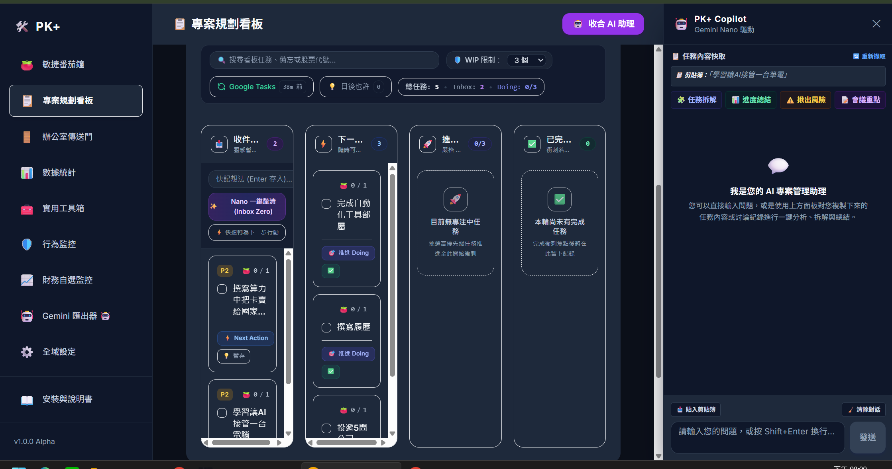

專案規劃看板uiux很醜 我再筆電上根本無法使用，因為介面太擠了
另外我想要合併card也很不好用 應該要可以拖曳A TO B 就進入編輯模式預設合併資料 方便我確定

管理看板的甬道應該主要顯示backlog & doing   ,idea ,done並不需要常駐顯示

update task manager template & sop 

doc裡面的文件需要分類管理、將專案工作區使用的檔案 區分於 插件開發代碼管理文件features作區別