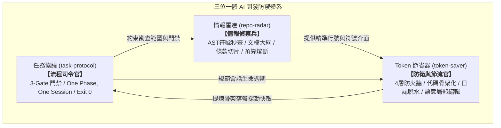

# Gate 1 探勘持久化快取：三大專家技能綜效使用流程方案 (The Triad Synergy Feature Doc)

- **目標文檔**：`0.doc_mg/docs/README_SKILLS_SYNERGY_WORKFLOW.md`
- **對應技能**：
  1. `.agents/skills/token-saver/SKILL.md` (Token 節省器)
  2. `.agents/skills/task-protocol/SKILL.md` (任務協議管理)
  3. `.agents/skills/repo-radar/SKILL.md` (專案情報雷達)

---

## 1. 三大技能職責與協同定位

| 專家技能 | 角色定位 | 核心工具 / 機制 | 解決痛點 |
| :--- | :--- | :--- | :--- |
| **task-protocol** | 流程司令官 (Lifecycle Commander) | `3-Gate Protocol` `One Phase, One Session` `task_cli.py (init/handover/archive)` `90/10 SSOT 分級` | 杜絕無序連跑、Context 膨脹、主觀猜測驗收與狀態遺失 |
| **repo-radar** | 情報偵察兵 (Intelligence Scout) | `repo_radar.py (map/outline/section/symbol/search)` `generate_symbol_index.py` | 杜絕全檔通讀盲讀 (Dump)、跨檔瞎 Grep、死鏈與超限檢索 |
| **token-saver** | 防衛與節流官 (Defense & Throttle) | `4-Layer Token Firewall` `code_skeleton.py` `compact_log.py` `rtk` `語意區塊編輯 (edit_file)` | 杜絕長源碼全讀、百行 Traceback 日誌污染、微片段編輯漂移 |

---

## 2. 端到端 3-Gate 綜效流水線 (Synergy Lifecycle)

### Gate 1: 脈絡藍圖期 (Session 1)
1. **Radar 勘查**：先以 `repo_radar.py map` 查閱全貌；對逾 100 行文檔使用 `outline` 與 `section` 切片精準吸取合約。
2. **Token-Saver 骨架化**：遇到長源碼調用 `code_skeleton.py --save 0.doc_mg/tasks/tmp/tmp_probe_*.md` 提取介面骨架並持久化。
3. **Task-Protocol 門禁鎖定**：調用 `task_cli.py init --plugin <plugin> --title <title>` 初始化任務檔，自動納入 Git 防護，填寫實證調用矩陣與行號錨點，輸出接力代碼塊後**強制停步交權**。

### Gate 2: 分段原子執行期 (Session 2 ~ N)
1. **Zero-Exploration 零探索冷啟動**：新 Session 讀取任務檔與 Gate 1 持久化快取檔，依錨定行號直接開工，嚴禁重頭通讀長檔。
2. **語意讀取與局部精準編輯**：
   - 讀取：以 80~150 行完整函式/組件自然語意為單位。
   - 編輯：使用原生 `edit_file` 進行 50~80 行具備唯一邊界的語意塊替換。
3. **終端日誌脫水**：建置/測試/報錯管線強制串接 `2>&1 | py 1.devtools/tools/compact_log.py`，脫水率 > 90%。
4. **2-Strike 熔斷**：單一問題重試上限 2 次，失敗即刻以 `log_issue.py log` 實體立案、還原髒代碼並停步交權。
5. **Phase Checkpoint 批次收斂**：單一 Phase 完成時，批次打勾、寫入單行歷程收斂，更新實體任務檔後輸出接力提示詞，立即交出控制權。

### Gate 3: 知識收斂與自動化審計期 (Session Final)
1. **Token-Saver 靜音自動化審計**：執行 `py 1.devtools/tools/audit_suite.py --compact`，以單行摘要確保全項 Exit 0。
2. **Radar 符號快取重建**：若有元件/符號異動，執行 `generate_symbol_index.py` 刷新 `.repo_index.json`，供後續任務 Gate 1 秒查。
3. **Task-Protocol SSOT 閉環與下沉歸檔**：
   - 90% 輕量任務豁免 L1~L3 SSOT，標記 `[N/A]`。
   - 10% 重大變更執行純骨架回寫。
   - 執行 `py 1.devtools/tools/task_cli.py archive` 自動下沉歸檔，保持 tasks 根目錄純淨。

---

## 3. 效益指標預估

- 探勘階段 Context 節約：**85% ~ 95%** (由全檔通讀 10k+ Tokens 降至 150~500 Tokens)。
- 終端建置/除錯日誌壓縮：**90.4%** (實測 160 行壓縮為 7 行高密度重點)。
- 會話隔離防膨脹：單會話鎖定在 **< 50,000 Tokens**，杜絕跨階段高水位失憶與幻覺。

