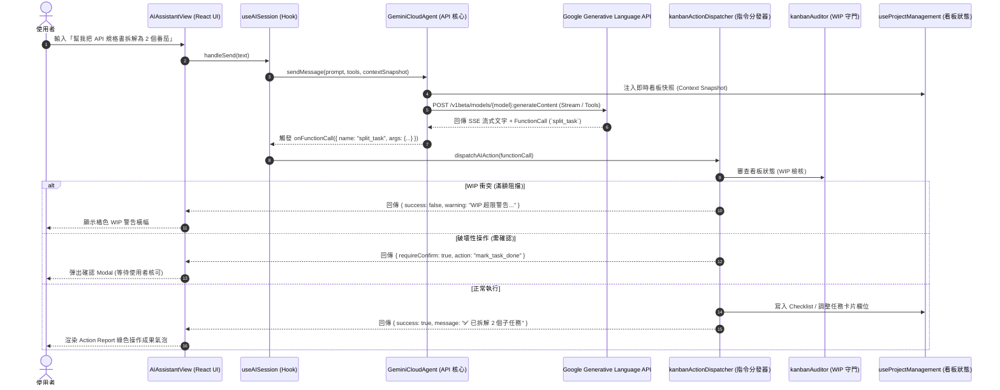

# ☁️ PK+ (Chrome ScrumClock) - Gemini Cloud Agent 與 Function Calling 技術規格書

> 文件路徑：`chrome_pk/docs/spec-pk-gemini-cloud-agent.md`  
> 模組代號：`pk-ai-cloud-agent`  
> 架構規範：Manifest V3、TypeScript + React 18 + Gemini REST API (v1beta) + Function Calling  
> 建立日期：2026-10-31  
> 狀態：SSOT 核心規格  

---

## 1. 系統定位與架構概述

PK+ (Personal Knowledge Plus) 側欄 AI 助理原為雙模式（本地 Gemini Nano 與官方 Gemini 網頁橋接）。為消除手動維護看板、拆解任務與拖拉卡片的摩擦成本，系統升級導入 **Gemini Cloud Agent** 作為第三 AI 引擎，支援 Gemini REST API 直連、SSE 即時流式輸出以及 **7 大看板操控 Function Calling**，使 AI 助理化身為能主動執行 GTD 與敏捷流程的「AI 指揮官」。

### 1.1 AI 三引擎模式速查矩陣

| 引擎模式 (`AIMode`) | 標識名稱 | 推理環境 | 核心優勢 | 典型適用情境 | 依賴需求 |
| :--- | :--- | :--- | :--- | :--- | :--- |
| `local_nano` | 🧠 Nano | 本機 Chrome (Prompt API) | 100% 離線隱私、零成本、即時回應 | 日記反思、即時語音筆記、隱私內容過濾 | Chrome 128+ 內建 AI |
| `gemini_cloud` | ☁️ Cloud | Google Gemini REST API | 強大邏輯推理、7 大看板操控 Function Calling、即時流式 | 敏捷任務拆解、自動排程、看板狀態操作、日報生成 | 個人 Gemini API Key |
| `official_bridge` | 🌐 官方 | 官方網頁 gemini.google.com | 享有 Web 官方 Gemini Advanced 算力與多模態 | 深度長文研報總結、複雜資料交叉分析 | 登入 Google 官方分頁 |

---

## 2. 系統架構與資料流向 (Data Flow)



---

## 3. 核心模組職責與實體對應

### 3.1 `GeminiCloudAgent.ts` (`chrome_pk/src/core/ai/GeminiCloudAgent.ts`)
* **職責**：
  1. 封裝 Gemini REST API 通訊（支援 `gemini-2.0-flash`、`gemini-1.5-pro`）。
  2. 動態建構 `Context Snapshot`：將當前看板各欄位（Backlog, Next-Actions, In-Progress, Done）任務數量、進行中標題與 WIP 上限打包注入 System Instruction。
  3. 宣告 `PK_TOOLS`（7 項 Function Calling 工具描述規範）。
  4. 支援 SSE 流式 Token 解析與 Function Call 參數彙整。

### 3.2 `kanbanActionDispatcher.ts` (`chrome_pk/src/features/project-management/services/kanbanActionDispatcher.ts`)
* **職責**：
  1. 作為 AI 指令與 React 狀態層之間的「防腐分發層」。
  2. 整合 `kanbanAuditor.ts` 執行 WIP 門禁：當 AI 企圖將卡片移至 `in-progress` 且進行中卡片數量達到上限（如 3/3）時，立即阻斷並回傳警示。
  3. 破壞性操作確認守門：如刪除卡片或批量標記完成時，先回傳 `requireConfirm: true`，由前端 UI 彈窗確認後二階段執行。
  4. 落地執行 7 大動作並回報標準化執行結果 (`ActionResult`)。

### 3.3 `useAISession.ts` (`chrome_pk/src/entries/sidebar/hooks/useAISession.ts`)
* **職責**：
  1. 管理三模狀態循環：`local_nano` ➔ `gemini_cloud` ➔ `official_bridge` ➔ `local_nano`。
  2. 讀取 `chrome.storage.local` 中的 `geminiApiKey`、`geminiModel` 與 `enableFunctionCalling` 設定。
  3. 協同調度 `GeminiCloudAgent` 與 `kanbanActionDispatcher`。

### 3.4 `AIAssistantView.tsx` (`chrome_pk/src/entries/sidebar/components/AIAssistantView.tsx`)
* **職責**：
  1. 提供三引擎切換按鈕視覺標籤。
  2. 渲染 `role: 'action_report'` 操作報告氣泡。
  3. 渲染 WIP 超限橘色警示橫幅。
  4. 渲染破壞性操作確認對話框 (Confirmation Modal)。

### 3.5 `SettingsPanel.tsx` (`chrome_pk/src/components/SettingsPanel.tsx`)
* **職責**：
  1. 提供個人 Gemini API Key 密碼輸入框（星號遮罩、即時寫入儲存）。
  2. 模型選擇器（預設 `gemini-2.0-flash`，可選 `gemini-1.5-pro`）。
  3. Function Calling 功能總開關。

---

## 4. 7 大 PK_TOOLS Function Calling 規格字典

AI 工具宣告位於 `GeminiCloudAgent.ts` 之 `PK_TOOLS` 常數，採用 Google Gemini OpenAPI 相容格式：

| 工具名稱 (`name`) | 語意功能 | 關鍵參數 (`parameters`) | 守門防護與行為 |
| :--- | :--- | :--- | :--- |
| `add_task` | 快速在看板指定欄位新增卡片 | `title` (string, 必填), `priority` ('P1'\|'P2'\|'P3'), `estimatedPomodoros` (number), `stage` ('backlog'\|'next-action'\|'in-progress'), `tags` (string[]) | 預設建立於 `next-action` 欄位；若直推 `in-progress` 需受 WIP 檢核。 |
| `split_task` | 將複雜任務拆解為 2~5 個子任務 | `parentTaskId` (string), `parentTaskTitle` (string), `subtasks` (Array<{ title: string, estimatedPomodoros: number }>) | 自動比對目標卡片，將子任務依序填入該卡片的 Checklist 結構。 |
| `move_task_stage` | 移動任務在看板各狀態欄間流轉 | `taskId` (string), `taskTitle` (string), `targetStage` ('backlog'\|'next-action'\|'in-progress'\|'done') | **嚴格 WIP 守門**：目標為 `in-progress` 時，先核對 WIP 是否超限，超限則拒絕移動。 |
| `mark_task_done` | 將任務標記為已完成 (Done) | `taskId` (string), `taskTitle` (string), `confirmed` (boolean) | **破壞性確認守門**：若 `confirmed` 未給予或為 false，回傳 `requireConfirm: true` 觸發彈窗。 |
| `start_pomodoro_sprint` | 針對指定任務啟動番茄鐘衝刺 | `taskId` (string), `taskTitle` (string), `durationMinutes` (number, 預設 25) | 自動切換任務狀態至 `in-progress`，並發送計時器衝刺事件。 |
| `generate_standup_report`| 聚合今日進度產出敏捷站會日報 | `timeRange` ('today'\|'this-week', 預設 'today') | 讀取即時看板卡片與番茄時鐘數據，格式化為包含已完成、進行中與阻礙事項的 Markdown 日報。 |
| `trigger_cloud_sync` | 手動觸發雲端 Google 服務同步 | `syncTarget` ('gas'\|'tasks'\|'calendar'\|'all', 預設 'all') | 呼叫 PK+ 後台 Google 生態或 Google Apps Script 雙向同步服務。 |

---

## 5. 安全、隱私與 Manifest V3 合規

1. **CSP 與 Permissions (白名單)**：
   - `chrome_pk/public/manifest.json` 在 `host_permissions` 中明確宣告 `https://generativelanguage.googleapis.com/*`。
   - 審計工具 `audit_manifests.py` 與 `audit_suite.py` 驗證完全合規 (Exit 0)。
2. **API Key 隱私保護**：
   - API Key 僅存放於使用者的本機 `chrome.storage.local` (`userSettings.geminiApiKey`)。
   - 所有前端與背景日誌程式碼中嚴禁以 `console.log` 打印 API Key 明文。
3. **WIP 限制 (Work In Progress Limit)**：
   - 看板進行中欄位設有容量限制（預設 3 張卡片）。AI 不得強制覆蓋此限制，必須落實看板健康保護。
4. **二階段確認 (Human-in-the-Loop)**：
   - 所有涉及狀態變更或刪除之高風險操作，落實人類確認介入，避免 LLM 幻覺誤刪任務。

---

## 6. 維護與擴充指南 (Developer Runbook)

### 6.1 如何新增第 8 項 Function Calling 工具
1. **宣告 Schema**：
   打開 `chrome_pk/src/core/ai/GeminiCloudAgent.ts`，在 `PK_TOOLS[0].functionDeclarations` 陣列中新增工具描述與參數定義。
2. **實作分發邏輯**：
   打開 `chrome_pk/src/features/project-management/services/kanbanActionDispatcher.ts`，在 `handleAction` 的 `switch (name)` 中新增 `case` 分支，處理業務邏輯並回傳 `ActionResult`。
3. **擴充單元測試**：
   打開 `chrome_pk/tests/test_gemini_cloud_agent.ts` 與 `chrome_pk/tests/test_kanban_action_dispatcher.ts`，加入新工具之名稱檢核與模擬調用驗證。
4. **執行驗證與打包**：
   ```powershell
   cd chrome_pk
   npx tsx tests/test_gemini_cloud_agent.ts
   npx tsx tests/test_kanban_action_dispatcher.ts
   npm run build
   ```

### 6.2 測試與回歸套件指令
* **GeminiCloudAgent 核心測試**: `npx tsx chrome_pk/tests/test_gemini_cloud_agent.ts`
* **看板分發器與 WIP 守門測試**: `npx tsx chrome_pk/tests/test_kanban_action_dispatcher.ts`
* **UI 整合與確認 Modal 流程測試**: `npx tsx chrome_pk/tests/test_phase5_ui_integration.ts`
* **建置檢查**: `cd chrome_pk; npm run build`
* **全域 Gate 3 自動化審計**: `py 1.devtools/tools/audit_suite.py --compact`

